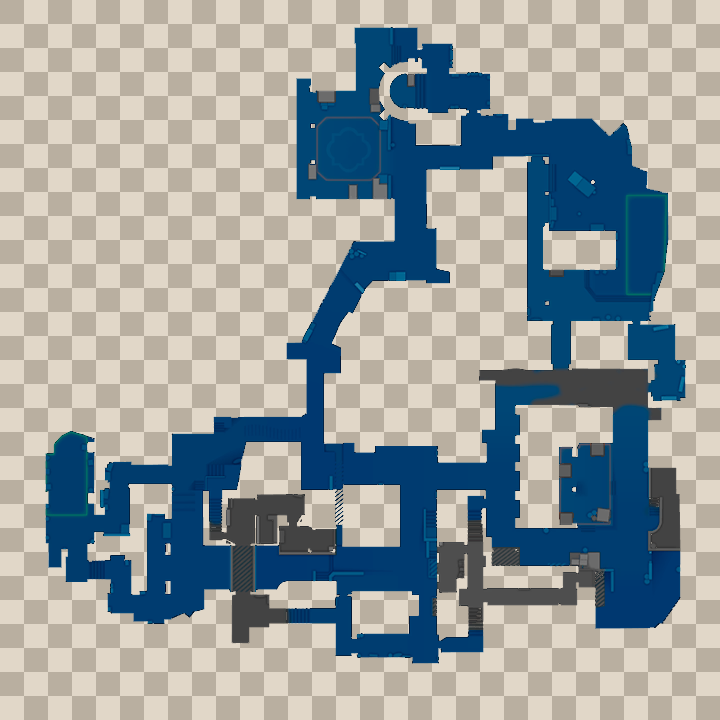

# Inferno Water 固定透明雷达标准

2026-11-03，用户明确批准本次清理后的图像，并要求：**“这张是最干净的，作为固定标准，不再更换。”**

## 固定文件

- 地图：`de_inferno_water`；工坊 ID：`3318429218`。
- 运行时标准：[`de_inferno_water_7a679a6781ea5bdd.png`](../../assets/radar_references/de_inferno_water_7a679a6781ea5bdd.png)。
- 大小：720×720，RGBA 真透明 PNG。
- PNG SHA-256：`7efdf576940999d6d9c1453f50081c4ced02b7b478255f0a49c804227371b2a7`。
- 透明像素：361804；可见像素：156596。
- 可见像素中 RGB 最大值不超过 48 的暗块数量：0。
- 对应源纹理 SHA-256：`3819a4866ec81406655950e9415dd7c2de633b69321b3f1e918ea673a542299f`。

预览中的棋盘格只用于展示透明区域，**不得烘焙进运行时雷达贴图**。

## 锁定规则

1. 标准 PNG 保持上述校验值，不再进行自动清理、滤波、阈值推断或轮廓补全；没有用户明确授权，不替换文件或改写其校验值。
2. `assets/radar_references/catalog.json` 将该记录标为 `locked: true`。目录导入工具遇到不同图像时必须拒绝覆盖；资源重扫、旧配置、道路恢复和黑底容差参数不得重新生成该图。
3. 标准图随 DLL 内嵌分发。其他用户选择相同地图时加载同一份基准，不依赖开发者电脑上的临时目录或外部图片。
4. 源纹理版本变化时记录版本差异，固定标准本身保持不变；不得悄悄换回自动推断图。替换基准需要用户重新明确授权。
5. 独立的背景不透明度设置属于显示效果，不得改写固定 PNG。默认使用完全透明背景。

## 清理依据

这份标准直接依据原始雷达的有效道路颜色生成，剔除了先前道路补全扩张出的边缘暗块，保留原坐标、道路和主要建筑轮廓，并将边缘暗色混合像素转换为有色透明过渡。已经批准后，以固定 PNG 为准，清理脚本和后续重新生成的候选图都不具有覆盖它的权限。

## 验证记录

- 固定图防覆盖测试 5 项通过，覆盖同版本重新导入、源版本变化、资源重扫、文件校验失败及非法资源路径。
- C++ 全量回归通过，本机 19 种已登记纹理版本完成加载验证；改变清理参数不会重新生成固定轮廓。
- 标准图以 RGBA8888 无损路径编译为原生纹理，再用独立解码器还原；与标准 PNG 的 RGBA 像素差异为 0。
- 中英文 DLL 均完成内嵌资源校验，标准 PNG 与上述 SHA-256 一致。
- 本次未启动 CS2 或 HLAE。加载新 DLL 后，点击更新并重新加载 Demo，确认游戏内显示效果。
