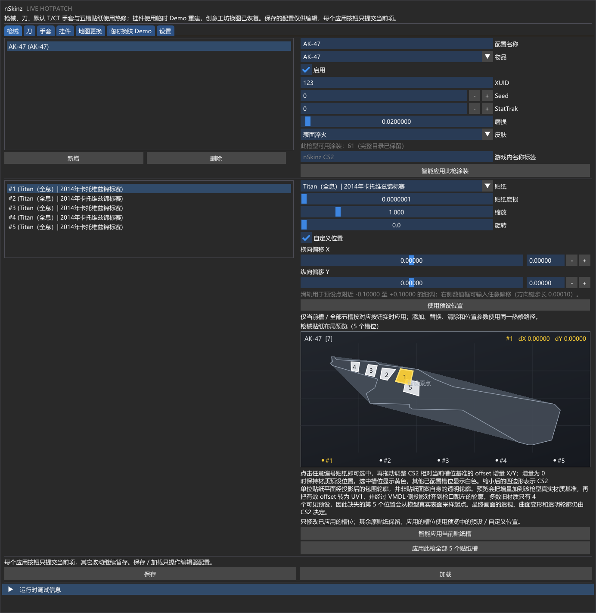

# nSkinzCS2 官方使用手册

**适用版本：v0.7.6 · 更新日期：2026-11-21**

nSkinzCS2 是面向 HLAE 离线 Demo 回放的 CS2 外观与创意工坊地图工具。本手册按当前发布版的控制面板和应用规则编写。旧版本教程中的应用路径可能已经变化。

[下载 v0.7.6](https://github.com/Lyan-edit/CS2-nskinz/releases/tag/v0.7.6) · [项目首页](https://github.com/Lyan-edit/CS2-nskinz) · [问题反馈](https://github.com/Lyan-edit/CS2-nskinz/issues)

## 第一次使用

1. 按[安装与加载](Installation-and-Loading.md)加载一个语言版本的 DLL。
2. 阅读[基本工作流与独立应用](Core-Workflow-and-Profiles.md)，理解 XUID、暂存和应用会话。
3. 只配置一个目标项目，点击该项目的智能应用按钮，确认结果后再增加其它项目。
4. 需要修改位置时，分别阅读[五槽贴纸](Stickers.md)和[挂件](Keychains.md)。

## 当前应用路径

| 项目 | 路径 | 应用入口 |
| --- | --- | --- |
| 枪械涂装、Seed、磨损、StatTrak、名称标签 | 当前 Demo 热修 | 智能应用此枪涂装 |
| 刀仅饰面、模型＋饰面 | 当前 Demo 热修 | 刀页当前配置的应用按钮 |
| 手套仅饰面、默认 T/CT 手套、换手套模型 | 当前 Demo 热修 | 手套页当前配置的应用按钮 |
| 五槽贴纸的新增、替换、清除与位置参数 | 当前 Demo 热修 | 当前贴纸槽／全部 5 个槽 |
| 挂件的新增、替换、清除与位置参数 | 临时 Demo 重建 | 智能应用此挂件 |
| 创意工坊地图与透明雷达 | 重映射后重载当前 Demo | 智能应用地图 |

**每个应用按钮只提交当前项。** 同时编辑了贴纸与刀，仅点击刀的应用按钮，会提交刀的配置；贴纸仍保持暂存。保存和加载也不会代替应用。

## 模块目录

| 章节 | 内容 |
| --- | --- |
| [安装与加载](Installation-and-Loading.md) | 下载、HLAE、加载指令、打开面板与升级 |
| [基本工作流](Core-Workflow-and-Profiles.md) | XUID、当前持枪者、独立按钮、保存与应用 |
| [枪械](Weapons.md) | 涂装筛选、Seed、磨损、StatTrak、名称标签 |
| [刀](Knives.md) | 仅饰面、换刀型、多普勒阶段与宝石标注 |
| [手套](Gloves.md) | 型号检测、默认 T/CT 手套、换型号 |
| [贴纸](Stickers.md) | 五槽、新增／替换／清除、预设与微调预览 |
| [挂件](Keychains.md) | 无挂件枪械新增、默认挂点、蓝色位置预览 |
| [临时 Demo](Temporary-Demo-Rewrite.md) | 仅挂件重建、原始文件、验证与失败日志 |
| [地图与雷达](Workshop-Maps-and-Radar.md) | 订阅扫描、换图、黑底、固定透明参考图 |
| [HUD 与名称](HUD-and-Names.md) | 右侧刀名／枪名、配置名称与改名标签 |
| [配置与诊断](Configuration-and-Diagnostics.md) | 文件位置、应用会话、目录、日志与迁移 |
| [故障排除](Troubleshooting.md) | 加载、面板、换肤、重建、雷达与卡顿 |
| [常见问题](FAQ.md) | 最常遇到的使用疑问 |
| [版本迁移与边界](Compatibility-Safety-and-Limitations.md) | 旧教程差异、兼容记录、预览与测试边界 |

## 当前控制面板

截图来自当前原生面板的直接渲染，展示五槽贴纸和独立应用按钮。它是界面示例，不代表该截图已连接游戏。

## 使用范围

通过 HLAE、带 `-insecure` 启动并播放离线 Demo。不要将 DLL 加载到联机服务器。本工具修改回放外观，不修改 Steam 库存，不提供真实饰品。

当前发布验证记录对应 CS2 `2000948 / 1.42.0.0`。客户端或 HLAE 后续更新后，应核对对应版本的发布说明。不能把离线自动测试理解为所有 Demo、地图、模型与帧时均已完成游戏内验证。

必要的许可与署名集中保留在主仓库的 [NOTICE](https://github.com/Lyan-edit/CS2-nskinz/blob/v0.7.6/NOTICE.md) 和[第三方声明](https://github.com/Lyan-edit/CS2-nskinz/blob/v0.7.6/THIRD_PARTY_NOTICES.md)。
