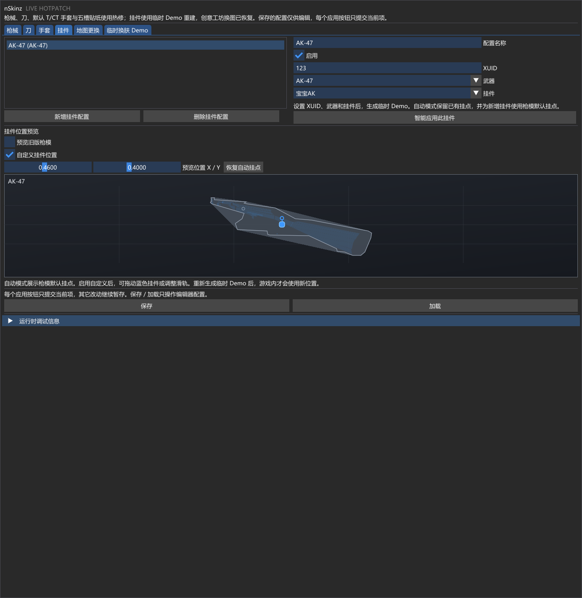

# 挂件新增、替换与位置预览

适用版本：v0.7.6。**挂件全部使用临时 Demo 重建。** 当前不提供挂件热修生成路径。

## 给原本没有挂件的枪新增

1. 正常播放原始 Demo，确认目标玩家及枪型。
2. 打开“挂件”，新增或选中配置，填写当前持枪者 XUID。
3. 选择枪型、挂件，勾选启用。
4. 先使用自动挂点，点击“智能应用此挂件”。
5. 程序从原始录制生成并验证临时 Demo，随后请求加载。进入回放后找到对应玩家与枪械检查。

已有挂件的替换步骤相同。自动模式保留已有挂点；给无挂件枪新增时使用枪模默认挂点。自动模式不等于把所有已有挂件都移到同一个位置。

## 自定义位置

1. 先选择枪型与有效挂件，展开位置预览。
2. 让程序检测枪模；仅在尚未检测时，按实际模型选择预览旧版枪模。
3. 勾选“自定义挂件位置”，从默认挂点开始调整。
4. 拖动蓝色挂件标记，或调整 `X / Y` 滑轨（0–1）。
5. 预览会即时更新；点击挂件应用后重新重建临时 Demo，游戏才会使用新挂点。

X/Y 是预览平面的归一化坐标，不是可以直接照抄到游戏世界中的米或厘米。模型检测已确认时，预览模型开关可能不可编辑。

“恢复自动挂点”会关闭自定义位置；随后仍需重新应用。实际悬挂、摆动与透视由游戏处理，面板不模拟完整物理运动。

## 不修改与清除

| 选择 | 含义 |
| --- | --- |
| `-`／不修改 | 不提出替换或清除请求 |
| 无挂件／移除 | 明确清除匹配枪械的挂件，需要重新生成临时 Demo |
| 指定挂件 | 替换已有挂件，或为可匹配的无挂件枪新增 |

停用配置和清除挂件是不同操作。需要移除源录制中已有挂件时，使用明确的移除选项。原始 Demo 不会被覆盖；重新播放原文件仍可看到录制中的挂件。

## 重建失败时

最常见的匹配条件是 XUID 与枪型：玩家可能不在这份录制、未持有配置的枪型，或填写的是上一份 Demo 的玩家。不能用“无挂件枪可以新增”推导成“没有相应枪械记录也可以凭空生成一把枪”。

失败时不要重复重建已生成的输出作为新源文件。保留原始 Demo，收集任务文件夹中的 `rewriter.log`，按[临时 Demo 页面](Temporary-Demo-Rewrite.md)排查。
